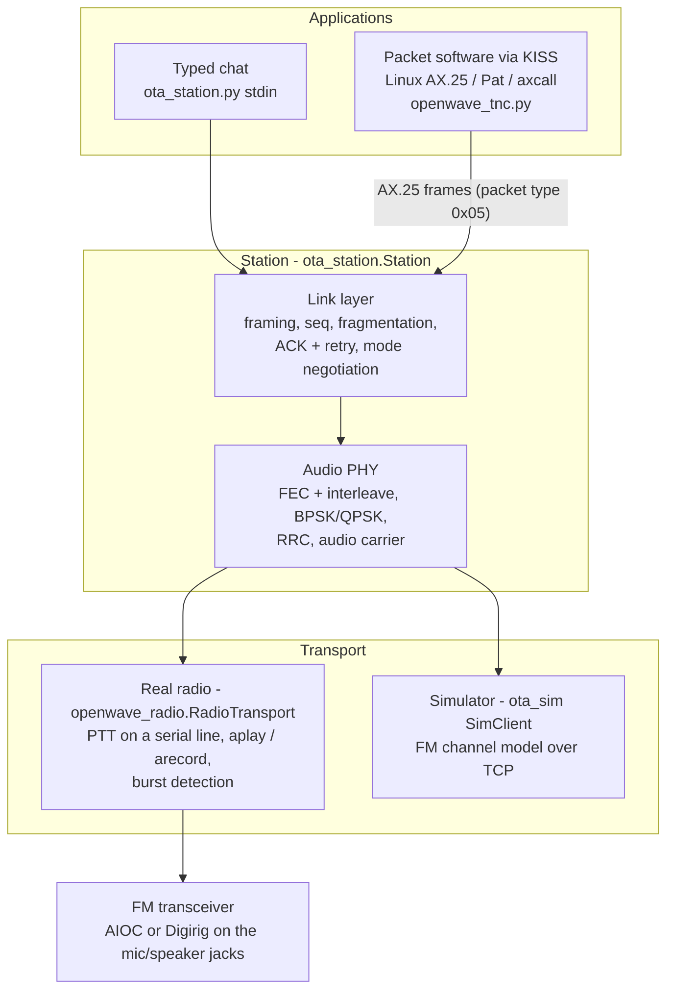
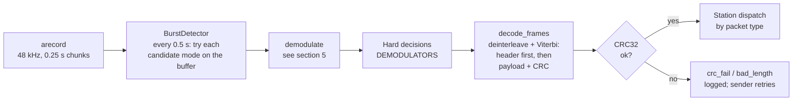
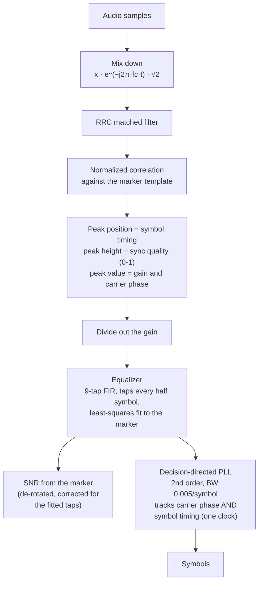
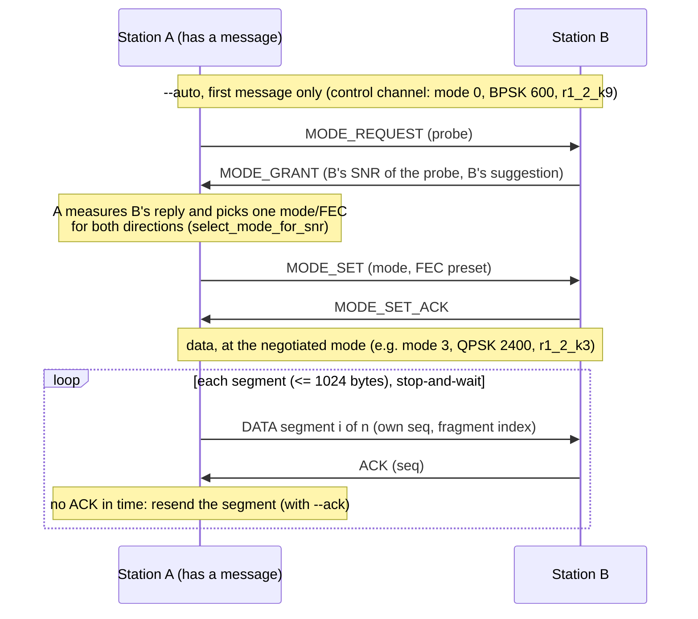

# OpenWave modem architecture

How a message becomes audio on a radio and back again: the layers, the
transmit chain, the receive chain, and the link layer above them. This
describes the **audio PHY** (a radio's mic/speaker or data port), which is
what runs on the air. The IQ PHY used with `ota_sim --channel iq` shares
the framing and FEC but swaps the audio blocks for complex baseband.

The diagrams are Mermaid (GitHub renders them). Numbers are the values in
the code as of 2026-10-08; the code is authoritative.

## 1. The big picture



Two applications sit on one station class. Chat uses the full OpenWave
link layer (fragmentation, ACKs, mode negotiation). The KISS TNC carries
AX.25 frames one per burst and leaves addressing, ACKs and retries to the
host's AX.25 stack. Either runs over a real radio or the simulator, with
the same modem code.

## 2. What a burst looks like on the air

```
 key-up   lead-in      marker (raw, 20 bytes)        FEC-coded blocks                 tail
 ┌─────┐┌──────────┐┌──────────────────┬─────────┐┌──────────────┬──────────────────┐┌────┐
 │ PTT ││ silence  ││ PN preamble      │ sync    ││ header       │ payload + CRC32  ││ 20 │
 │ 0.2s││ 250 ms   ││ 16 bytes         │ 1ACFFC1D││ 20 B, coded  │ <=1024+4 B, coded││ ms │
 └─────┘└──────────┘└──────────────────┴─────────┘└──────────────┴──────────────────┘└────┘
                     ^ receiver correlates on this: timing, phase, level, equalizer
```

- **Lead-in silence** covers the far radio's key-up and squelch opening
  (`--lead-in-ms`, default 250).
- **Marker** = the first 16 bytes of a fixed PN preamble + the 4-byte sync
  word (`openwave_link.AUDIO_MARKER`). It is never FEC-coded: the receiver
  needs it before it knows anything else.
- **Header** (20 bytes, `>BBBH6s6sHB`): version and packet type (4 bits
  each), mode ID, flags, sequence number, source and destination callsigns
  (packed base-40, up to 9 characters each), payload length, fragment
  index.
- **Payload + CRC32**: up to 1024 bytes, CRC over header + payload.
- The header and the payload+CRC are **coded as two separate blocks**, so
  the receiver can decode the header first and learn how long the payload
  block is.

Packet types: `0x01` data, `0x02` ACK, `0x03` beacon, `0x04` control
(mode negotiation, ping), `0x05` AX.25.

## 3. Transmit chain

```mermaid
flowchart LR
    msg["Message<br/>or AX.25 frame"] --> frag["Fragment<br/>to <=1024 B"]
    frag --> frame["build_frame<br/>header + payload + CRC32"]
    frame --> afr["frame_for_audio<br/>16-byte preamble marker,<br/>no padding"]
    afr --> fec["encode_frame<br/>convolutional code per block<br/>+ golden-ratio interleaver<br/>marker left raw"]
    fec --> map["Symbol map<br/>BPSK or QPSK"]
    map --> rrc["RRC pulse shape<br/>alpha 0.35, 11 symbols"]
    rrc --> mix["Mix onto carrier<br/>1650 Hz modes 0-2<br/>2000 Hz mode 3"]
    mix --> pad["Add lead-in silence<br/>and tail"]
    pad --> lvl["Normalize peak<br/>to --tx-level"]
    lvl --> ptt["Wait turnaround,<br/>key PTT, play,<br/>release"]
```



| Step | Code | Notes |
|---|---|---|
| Fragment, frame | `openwave_link.build_fragmented_frames`, `build_frame` | one frame per fragment, each an independent burst |
| Audio framing | `openwave_audio.frame_for_audio` | swaps the IQ PHY's 32-byte preamble and padding for the 16-byte audio marker |
| FEC | `openwave_fec.encode_frame` | K=3/7/9 convolutional codes at rates 1/2 to 1/6 (`PRESETS`); each block gets its own flush tail and is interleaved (golden-ratio permutation) so a fade's burst of errors is spread out for the Viterbi decoder |
| Modulate | `modulate.MODULATORS`, `openwave_audio.modulate` | 48 kHz audio; samples per symbol = 48000 / symbol rate (80, 40, 20) |
| Carrier | `openwave_audio.carrier_for` | per port and symbol rate (table below) |
| Transmit | `openwave_radio.RadioTransport._tx_loop`, `ptt_play.key_and_play` | waits `--turnaround-ms` (600) after the last received burst, keys DTR or RTS, waits 0.2 s, plays with `aplay`, releases; the receiver is muted while keyed and 0.4 s after |

## 4. Receive chain



- **Burst detection** (`openwave_radio.BurstDetector`): the receiver
  doesn't know when a burst will arrive or in which mode. Every 0.5 s it
  tries each candidate (the station's current data mode and the control
  channel's mode 0) on the buffered audio. A decoded burst is handed over
  and the buffer trimmed past it. If two bursts are in the buffer it
  hands over the earliest first. A burst that is heard (marker found) but
  doesn't decode yet is waited on for up to 8 s, in case it is still
  arriving.
- **Decoding** (`openwave_fec.decode_frames`) starts at the marker
  position the demodulator found, decodes the 20-byte header, reads the
  payload length from it, then decodes exactly that many payload bytes and
  checks the CRC.
- **Multiple candidates** (`Station._handle_received_samples`): each
  candidate mode is tried until one yields a CRC-good frame, so the same
  receiver hears both data bursts and control bursts.

## 5. Inside the demodulator

`openwave_audio.demodulate` - all of a burst's synchronization comes from
the one known marker:



- **Correlation** gives three things at once: where the burst starts (to
  the sample), its carrier phase (which also resolves QPSK's 90° ambiguity,
  since the reference is the actual marker) and its level. The normalized
  peak (`quality`) is near 1 for a clean burst and ~0.1 for noise; the
  detector treats >= 0.4 as "heard".
- **Equalizer** (added 2026-10-08): an HT's mic/speaker path tilts several
  dB across the band, which smears each symbol into its neighbours. The
  FIR is refitted for every burst from the marker, so it needs no training
  exchange and follows whatever radios are in use. On air it raised
  whole-burst SNR by 3-11 dB (RADIO_SETUP.md, "Receive equalizer").
- **SNR** is data-aided (the marker's known symbols), after de-rotating any
  residual frequency offset across the marker. It drives mode selection.
- **PLL**: two sound cards never run at exactly the same rate. In an
  audio modem the carrier and the symbol clock come from the same sample
  clock, so one clock offset shows up as both a carrier frequency offset
  and a timing drift. The loop tracks phase and converts its frequency term
  back into a timing correction: one loop, no separate timing recovery.

## 6. Link layer and station



- **Fragmentation**: messages over 1024 bytes are split; the receiver
  reassembles by sequence number and fragment index
  (`openwave_link.LinkReceiver`, `FragmentReassembler`) and suppresses
  duplicates from retries.
- **ACK and retry** (`--ack`): stop-and-wait, one segment at a time. Each
  segment has its own sequence number and must be acknowledged before the
  next is sent; the reply timeout allows for airtime, the radio transport's
  overhead and the turnaround. This is why long messages settle near
  160 chars/s at mode 3 (RADIO_SETUP.md, "Message length test"); sending
  several segments per turn (burst batching) is the planned improvement.
- **Mode negotiation** (`--auto`, `Station.negotiate`): the first time a
  station has something to send, it probes the link on the robust control
  channel and both stations switch to one mode/FEC.
  - The pick comes from `MODE_SNR_TABLE`, judging each row at its own
    symbol rate (a faster mode sees more of the noise).
  - It switches to `FADING_MODE_SNR_TABLE` when a burst shows fading
    dropouts (`openwave_audio.burst_quality`).
  - It is capped by the audio port's maximum symbol rate.
- **AX.25** (packet type `0x05`, the KISS TNC): bypasses fragmentation,
  ACKs and negotiation. Every received AX.25 frame goes up to the KISS
  host, like any TNC; the mode and FEC are fixed by `--mode` on both TNCs.

## 7. Modes and carriers

| Mode | Modulation | Symbols/s | Raw bit/s | Carrier (mic port) | Band (carrier ± rate × 1.35 / 2) |
|---|---|---|---|---|---|
| 0 | BPSK | 600 | 600 | 1650 Hz | 1245-2055 Hz |
| 1 | BPSK | 1200 | 1200 | 1650 Hz | 840-2460 Hz |
| 2 | QPSK | 1200 | 2400 | 1650 Hz | 840-2460 Hz |
| 3 | QPSK | 2400 | 4800 | 2000 Hz | 380-3620 Hz |
| 4 | QPSK | 4800 | 9600 | - | needs ~6.5 kHz of audio |
| 5 | 16-QAM | 9600 | 38400 | - | needs ~13 kHz of audio |

Data throughput is the raw rate times the FEC rate (1/2 for the presets
`--auto` uses on good links). Modes 4 and 5 don't fit an FM radio's audio
path: nothing above ~4 kHz got through the HTs tested
(`radio_response.py`). The `data` port profile (a radio's flat 6-pin data
connector) uses 2000 Hz for every mode, up to mode 3.

## 8. Where it lives

| File | Role |
|---|---|
| `openwave_link.py` | header, frame building/parsing, callsigns, fragmentation, ACK/control frames, mode tables, `select_mode_for_snr` |
| `openwave_fec.py` | convolutional codes, Viterbi, interleaver, `encode_frame` / `decode_frames` |
| `openwave_sync.py` | marker search in bits (uncoded path) |
| `modulate.py`, `demodulate.py`, `openwave_modem.py` | symbol mapping and hard decisions |
| `openwave_pulse.py` | RRC filter taps |
| `openwave_audio.py` | audio PHY: carriers, `modulate`, `demodulate` (correlation, equalizer, PLL), burst quality |
| `openwave_radio.py` | real-radio transport: burst detection, PTT + playback, turnaround |
| `ptt_play.py`, `radio_stations.py` | PTT keying; finding AIOC / Digirig interfaces |
| `ota_station.py` | the station: link layer, negotiation, ACKs, live chat CLI |
| `openwave_tnc.py`, `openwave_kiss.py` | KISS TNC on top of the station |
| `OpenWave_Specification.txt` | the normative wire format |
